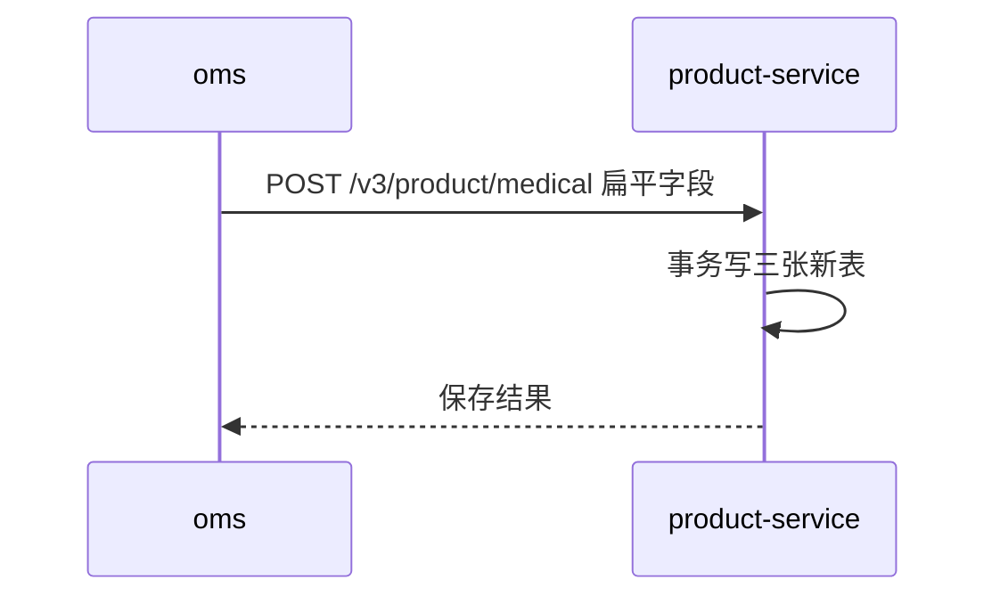

# 示例：药品数据治理方案（演示文档）

> 文档版本：v3 ｜ 修订：2026-09-28（v2）、2026-09-29（v3） ｜ 仓库：`backend/mall/product-service`
> v2 ＝ v1 + 初始化脚本幂等化：唯一键去掉 `delete_flag`，「清空→重加→再清空」不再报 `Duplicate entry`，重配置由 upsert 复活旧行（修订决策 15/16、§4、§3.1）。
> v3 ＝ v2 + 留痕取值文案按属性名分派：新增 4 个字段此前打印原始值（`【禁用性别】修改前：null，修改后：2`），改为 `1男禁用`/`2女禁用`/`3男女均禁`、`是`/`否` 的可读文案；既有分支与既有字段不动。
> 变更沿革：v1 原列归移动医疗端 → v2 端归属翻转 → v3 留痕文案分派。本文档约定：不引用代码行号，代码定位一律用符号名或文本锚点，行号随每次改动漂移，符号名可全文检索定位。

## 1. 需求简述

- 药品主数据新增「精神类药物」（二值：是 / 否）
- 新增「禁用性别」独立功能（与既有 ~~specific_sex~~ 指定性别用药无耦合）
- 原「禁用年龄」拆为「商城端禁用年龄」+「移动医疗端禁用年龄」
- 需求来源：PMS 需求单（口头澄清，无 PRD），详见[项目管理平台](https://example.com/pms/story/123)

## 2. 方案概要

核心思路：字段落点全部由新表承接，`medical` 主表本期零新增列（避免继续加宽约 45~50 列的现有宽表）。

| 变更 | 对象 | 说明 |
| --- | --- | --- |
| 新增表 | `medical_special_drug` | 药品法定分类，行 = 维度 |
| 新增表 | `medical_restriction` | 药品级管控规则，`control_code` + `value_int` |
| 新增表 | `medical_channel_restriction` | 按渠道年龄限制，行 = 药品 × 渠道 |
| 无新增列 | `medical` 主表 | 既有列直接退役，读侧改读 `MALL` 行 |

### 2.1 数据库变更

```sql
CREATE TABLE medical_restriction (
  id                 BIGINT       NOT NULL AUTO_INCREMENT COMMENT '主键',
  medical_id         INT          NOT NULL COMMENT '药品主数据ID',
  control_code       VARCHAR(32)  NOT NULL COMMENT '管控维度：FORBIDDEN_SEX',
  value_int          INT          NOT NULL COMMENT '取值：1男禁用/2女禁用/3男女均禁',
  delete_flag        TINYINT      NOT NULL DEFAULT 0 COMMENT '删除标记',
  PRIMARY KEY (id),
  UNIQUE KEY uk_medical_restriction (medical_id, control_code)
) ENGINE=InnoDB DEFAULT CHARSET=utf8mb4 COMMENT='药品级管控规则';
```

### 2.2 数据核对

上线前须执行影响面查询并导出明细：

```sql
-- 6.1 会被 MALL 行覆盖「反转」的药品
SELECT COUNT(*) AS reversed_only_greater
FROM medical m
WHERE m.sell_online_flag = 1
  AND m.forbidden_age_less IS NULL
  AND m.forbidden_age_greater IS NOT NULL;
```

### 2.3 配置示例

写侧取值域校验配置（节选）：

```json
{
  "control_code": "FORBIDDEN_SEX",
  "allowedValues": [1, 2, 3],
  "filterable": false,
  "description": "禁用性别，不分端"
}
```

### 2.4 部署步骤

```bash
# 1. 执行 DDL
mysql -h prod -u dba mall_product < sql/20260920_init_ddl.sql
# 2. 灌入初始化数据（幂等，可重复执行）
mysql -h prod -u dba mall_product < sql/20260920_init_data.sql
# 3. 核对结果
mysql -h prod -u dba mall_product < sql/20260920_check.sql
```

## 3. 关键流程



## 4. 流程示意截图


（上图文字转写如下）

1. 运营提交药品属性变更
2. 质管复核精神类药物标记
3. 系统写留痕并同步渠道表

## 5. 测试关注点

1. **翻译正确性**：扁平入参 ↔ 三张表双向一致；越界值（`0`/`4`）须被拒绝
2. **整行回写回归**：编辑疾病词后，关联药品在新表的行内容与 `last_modified_date` 均不得变化
3. **异常边界**：只填「大于」不填「小于」；年龄 0/100/非数字；未提交字段（`null`）不得被清空

> 回滚前提：DDL 尚未在任何环境执行。回滚 = 前后端回版本，数据回滚 = 清空三张新表。
